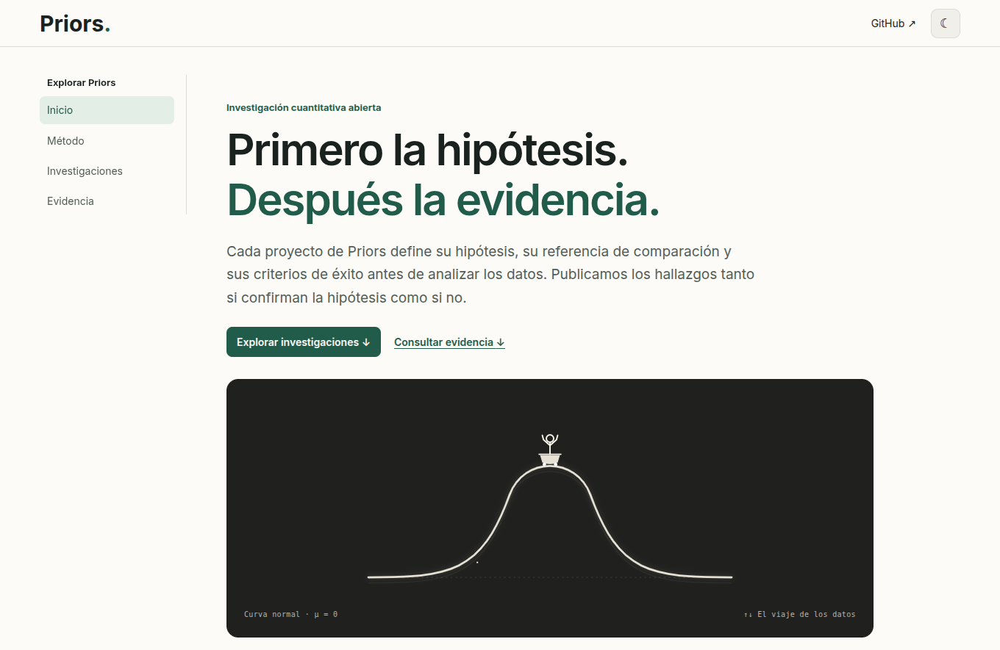

# Priors

*[Leer en español ↓](#priors-español)*

[](https://santiagocsm.github.io/priors/)

A home for open, pre-registered quantitative research across topics.
Each research project lives in its own repository, with its own data
pipeline and its own published site — this repo is the index: it lists
every project and aggregates each one's decision board (`board.md`)
live at build time, so the state of every hypothesis is visible in one
place without manually copying anything.

## How it works

- `src/data/projects.ts` — the list of linked research repositories
  (name, description, site URL, and where to find `board.md`).
- `src/lib/fetchBoard.ts` — at build time, fetches and parses each
  linked repo's `board.md` directly from GitHub (raw content, no
  submodules, no manual sync).
- `src/pages/index.astro` — renders the project list and the
  aggregated status table.

Adding a new research project means adding one entry to
`projects.ts` — nothing else changes.

## Development

```bash
npm install
npm run dev       # http://localhost:4321
npm run build     # outputs to dist/
```

## Deployment

Pushes to `main` trigger `.github/workflows/deploy.yml`, which builds
the site with Astro and publishes it to GitHub Pages.
The same workflow also refreshes the linked `board.md` files every six hours
(UTC) and can be started manually. If a linked board cannot be read, the
build stops rather than replacing the published page with incomplete results.

## Linked projects

- [btc_candles_research](https://github.com/nobodywhois0/btc_candles_research) — is there a statistical edge in BTC/USDT's 5-minute candle direction?

---

# Priors (Español)

*[Read in English ↑](#priors)*

Un lugar para investigación cuantitativa abierta y pre-registrada en
distintos temas. Cada proyecto de investigación vive en su propio
repositorio, con su propio pipeline de datos y su propio sitio
publicado — este repo es el índice: lista cada proyecto y agrega el
tablero de decisión (`board.md`) de cada uno en vivo durante el build,
para que el estado de cada hipótesis sea visible en un solo lugar sin
copiar nada a mano.

## Cómo funciona

- `src/data/projects.ts` — la lista de repositorios de investigación
  conectados (nombre, descripción, URL del sitio, y dónde encontrar
  `board.md`).
- `src/lib/fetchBoard.ts` — en build time, descarga y parsea el
  `board.md` de cada repo conectado directamente desde GitHub
  (contenido raw, sin submódulos, sin sincronización manual).
- `src/pages/index.astro` — renderiza la lista de proyectos y la tabla
  de estado agregada.

Agregar un proyecto de investigación nuevo significa agregar una
entrada en `projects.ts` — nada más cambia.

## Desarrollo

```bash
npm install
npm run dev       # http://localhost:4321
npm run build     # genera en dist/
```

## Despliegue

Los pushes a `main` disparan `.github/workflows/deploy.yml`, que
construye el sitio con Astro y lo publica en GitHub Pages.
El flujo también vuelve a consultar los archivos `board.md` cada seis horas
(UTC) y permite ejecución manual. Si no se puede leer un registro, la
compilación se detiene para no reemplazar el sitio con resultados incompletos.

## Proyectos conectados

- [btc_candles_research](https://github.com/nobodywhois0/btc_candles_research) — ¿existe un edge estadístico en la dirección de la vela de 5 minutos de BTC/USDT?
